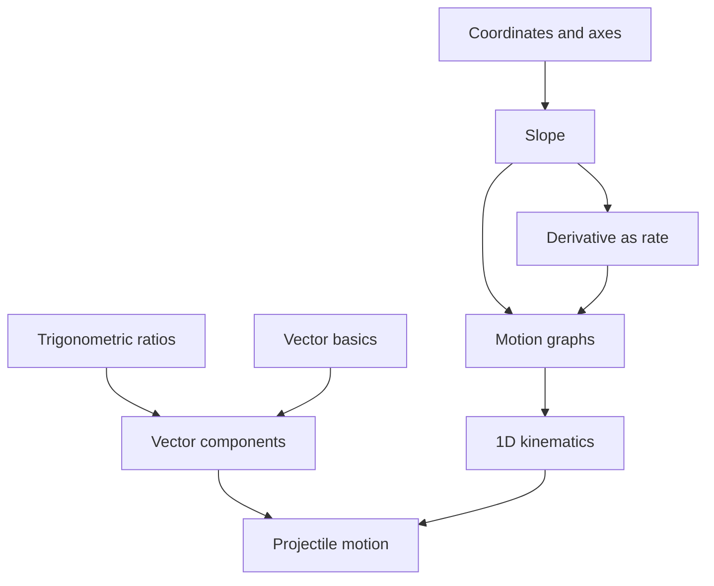
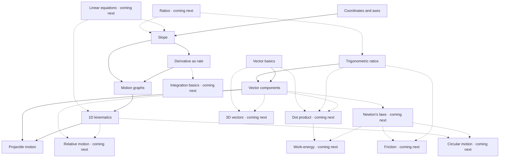

# Knowledge graph: idea v3

Status: graph structure implemented; educational design and roadmap links pending builder review. No builder approval or student learning evidence is implied by this document.

The graph has **9 concepts in the live scope, 9 live links, 10 coming-next topics and 19 proposed display-only links**. A live-scope concept becomes usable only when the required questions and repairs have been approved under idea.md section 5. The graph alone does not make content eligible for serving.

## 1. What a link means

An arrow points from a supporting concept to the topic that uses it. Diagnostic investigation runs in the opposite direction, from the problem towards possible contributing gaps.

The nine live links reproduce idea.md section 4.1, including the user-requested coordinates-before-slope amendment. They define a selected route for investigating this question bank; they are **not universal necessary prerequisites**. For example, derivatives support interpreting a curved position-time graph, but a straight-line graph can be read using ordinary slope. A student should not be assigned a calculus gap merely because a kinematics answer is wrong.

Coming-next links are proposed connections for display and connection counts only. They cannot enter the probe queue, produce a state, receive a question or serve a repair. Their presence is not a coverage claim.

## 2. Live structure

The labels below describe the bounded skill each node tests, not mastery of an entire chapter.

| ID | Bounded skill | Deliberately excluded | Check prerequisites in this order |
|---|---|---|---|
| `coordinates` | Ordered pairs, origin, axis labels, positive directions and tick scales | Slope, distance/section formulae, equations of lines | None in live scope |
| `trig` | Identify sides relative to the marked angle; ratios and standard-angle values | General identities, equations, inverse trig, radians | None in live scope |
| `vec_basics` | Magnitude versus direction; translation and graphical addition/subtraction | Dot/cross products, torque, advanced 3D geometry | None in live scope |
| `slope` | Signed vertical change / horizontal change, with actual axis scales | Symbolic differentiation, general tangent equations | `coordinates` |
| `vec_comp` | Signed 2D components, with the angle's reference axis explicit | Non-orthogonal axes and 3D resolution | `trig`, then `vec_basics` |
| `deriv_rate` | Local rate/tangent slope versus average rate/function value | Chain rule, formal limit proofs, general differentiation | `slope` |
| `motion_graphs` | Slopes of x–t and v–t graphs; signed area of simple v–t graphs | General integration, complex discontinuities | `slope`, then `deriv_rate` |
| `kin_1d` | Signs, displacement and valid use of constant-acceleration relations | Variable acceleration, multi-body constraints | `motion_graphs` |
| `projectile` | Two component motions, common time, constant gravity, negligible drag | Drag, moving platforms, inclined-plane range, collisions | `vec_comp`, then `kin_1d` |

The chapter picker exposes `projectile`, `kin_1d`, `motion_graphs` and `vec_comp`. Other live concepts are entered through investigation or a future foundation check.

### Educational caveats to review

1. **The calculus branch is a teaching route.** `deriv_rate -> motion_graphs` applies to local-rate reasoning, not every graph item. `motion_graphs -> kin_1d` represents the graphical explanation of the equations, not a requirement for every use of them. Keep item stems aligned with these interpretations.
2. **Levels are layout data.** `deriv_rate` and `motion_graphs` both have level 2 despite a link between them. Detect cycles from edges, not by requiring every edge to increase the level.
3. **There are missing lower skills.** Arithmetic, algebraic manipulation, right-triangle geometry, units and signed area lie partly below the nine-node scope. The product must not pretend a failed item isolates one of the listed concepts when those skills could explain it.
4. **A passing dependent does not certify prerequisites.** Record exactly what was checked; use neither graph reachability nor a green dependent to manufacture prerequisite evidence.
5. **An unrelated tagged distractor is not an explanation.** Candidate tags in `graph-review.ts` are authoring suggestions pending review. Question wording and distractors must justify each tag.

## 3. Coming-next connections

Dashed arrows are proposed display-only learning-support links. Grey nodes must be labelled "coming next" when rendered; do not infer states for them.

Foundational roadmap nodes point **into** live concepts, while application nodes point outwards. Neither direction changes the locked diagnostic prerequisites. For instance, ratios may support trigonometry, but a ratios question is outside the current bank.

The proposed links describe chosen treatments: components for Cartesian dot products, components for force resolution, and Newton's laws for circular-motion force problems. They do not imply those are the only ways to learn or solve the broader topics. Each display link has its rationale in `graph-roadmap.ts`.

## 4. Connection counts

Count distinct reachable nodes, excluding the selected node. A topic reached through two paths counts once. Never count prerequisites, duplicate paths, or question items as later topics.

Use `connectionSummary(id)` in the interface so the number always includes a visible breakdown. `descendantsOf(id)` remains restricted to the live graph for engine consumers. `mapDescendantsOf(id)` includes display-only roadmap links.

For vector components, the current proposed map gives:

- **1 live-scope later topic:** projectile motion.
- **7 coming-next topics:** relative motion, dot product, Newton's laws, friction, work-energy, circular motion, 3D vectors.
- Suggested copy: **"Connected to 8 later topics: 1 in this version, 7 coming next."**

These counts are design outputs, not estimates of questions saved, topics mastered or learning improvement. Counts change when the reviewed graph changes. The full-map total should never be presented without its future-coverage qualification.

## 5. The six-probe demo

Investigation runs backwards from `projectile`. The stored prerequisite order determines what to inspect first.

| Probe | Concept/item | Example observed result | Consequence |
|---|---|---|---|
| 1 | `projectile` B1 | Wrong | Ask the standard item |
| 2 | `projectile` A | Correct | Context difficulty; investigate components first |
| 3 | `vec_comp` B1 | Wrong | Ask the standard item |
| 4 | `vec_comp` A | Correct | Context difficulty; investigate trig, then vector basics |
| 5 | `trig` B1 | Correct, not Guess | No difficulty found in this probe |
| 6 | `vec_basics` B1 | Correct, not Guess | Supports reporting vector components as a suspected contributing gap |

Report **"Suspected contributing gap: vector components."** Keep `kin_1d` and its untested branch explicitly untested. The result says something about these observations, not the exclusive cause of the original mistake.

B2 and the R reasoning item are repair checks outside the probe budget; they are not additional graph nodes. Neither immediate success nor connection count proves retention. No question in this document is an approved assessment item.

## 6. Reference corrections

Reference locations were checked against the official NCERT PDFs on 10 October 2026. They locate the relevant concepts; they do not validate our diagnostic arrows or question bank. Section numbering can differ across editions.

| Nodes | Verified reference |
|---|---|
| `coordinates` | [Class 10 Maths, Chapter 7, §7.1 (coordinate-axes recap)](https://ncert.nic.in/textbook/pdf/jemh107.pdf) |
| `trig` | [Class 10 Maths, Chapter 8, §§8.2–8.3](https://ncert.nic.in/textbook/pdf/jemh108.pdf) |
| `vec_basics` | [Class 11 Physics, Chapter 3, §§3.2–3.4](https://ncert.nic.in/textbook/pdf/keph103.pdf) |
| `vec_comp` | [Class 11 Physics, Chapter 3, §3.5](https://ncert.nic.in/textbook/pdf/keph103.pdf) |
| `projectile` | [Class 11 Physics, Chapter 3, §§3.8–3.9](https://ncert.nic.in/textbook/pdf/keph103.pdf) |
| `slope` | [Class 11 Maths, Chapter 9, §9.2](https://ncert.nic.in/textbook/pdf/kemh109.pdf) |
| `deriv_rate` | [Class 11 Maths, Chapter 12, §§12.2 and 12.5](https://ncert.nic.in/textbook/pdf/kemh112.pdf) |
| `motion_graphs` | [Class 11 Physics, Chapter 2, §§2.2–2.4](https://ncert.nic.in/textbook/pdf/keph102.pdf) |
| `kin_1d` | [Class 11 Physics, Chapter 2, §2.4](https://ncert.nic.in/textbook/pdf/keph102.pdf) |

The prior graph pointed projectile motion to §3.10, which is uniform circular motion in the checked edition. It also used an old derivatives chapter number and motion sections not present in the checked edition. Those references are corrected in `graph.ts`.

## 7. Integration and review

- `app/content/graph.ts`: nine diagnostic nodes, suspect order, verified references, display-node/edge projections and traversal/count functions.
- `app/content/graph-roadmap.ts`: ten non-diagnostic topics and proposed display-only connections.
- `app/content/graph-review.ts`: bounded concept definitions, candidate misconception tags, live-edge explanations and review limitations.
- `app/tests/graph.test.ts`: graph integrity, cycle detection, diagnostic/display separation, duplicate-free reachability and connection-count checks.

Builder review remains necessary for the concept boundaries, roadmap links, and all A/B1/B2/R items. In particular, confirm which motion-graph items actually require local-rate reasoning. Enable a node through the content-approval gate only after its required items and repairs have been approved. Do not mark this graph human-reviewed merely because automated checks pass.

## 8. Coordinates-before-slope amendment

`coordinates` is an L0 live-scope foundation with no in-map prerequisites. The new edge is `coordinates -> slope`. Read the points and axis scales first; only then compare changes to calculate slope. A coordinate-reading error and a ratio/slope error should receive different candidate tags and repairs. The four chapter-picker entries and the projectile demo path are unchanged.

The node is part of the live graph structure; its A, B1, B2 and repair content still require builder approval before serving. This increases the planned bank from 28 to 31 items. NCERT §7.1 provides a coordinate-axes recap; axis-scale interpretation also needs a reviewed example in the repair content.

## 9. Interactive map and vertical-order rule

The interface follows the BharatLens graph treatment (dark canvas, directed curves, pan/zoom and a concept inspector), with a strict prerequisite ordering requested for this learning map:

- Rank is the longest prerequisite path in the visible DAG. Foundations are at the bottom; every dependant is strictly above its prerequisites.
- Dragging changes horizontal placement only. Vertical rank stays fixed during dragging and simulation.
- Selecting a concept colours all transitive prerequisites blue, the selected concept gold, and all transitive dependants green. Unrelated nodes fade; siblings are not inferred to be prerequisites.
- Category colours apply when no concept is selected. The selection legend explains the relationship colours separately from progress states.
- Planned concepts and connections remain dashed and display-only. Search can reveal a planned concept without making it eligible for assessment.
- The mobile map uses a narrow, taller layout and wrapped labels. Concepts support keyboard selection, with search as an alternative to pointer navigation.

`app/lib/graph-layout.ts` computes ranks and directed reachability. Its tests cover both current and planned maps, transitive highlights, unrelated siblings, and cycle rejection. All direct instructional edges are retained; this is a Hasse-style ordering, not a mathematical transitive reduction.

## 10. Audit against official JEE syllabi (10 October 2026)

Sources read in full: JEE Main 2026 syllabus (NTA PDF) and JEE Advanced 2026 syllabus (jeeadv.ac.in; it states it is unchanged from 2025). NCERT section headings were re-read from the official PDFs.

**Confirmed**
- All nine live nodes and nine live edges map to syllabus items. NCERT refs verified: Class 10 Ch 7 s7.1, Ch 8 s8.2-8.3; Class 11 Physics Ch 2 (s2.2-2.4 incl. x-t and v-t graphs, area under v-t), Ch 3 s3.2-3.5 and s3.8-3.9; Class 11 Maths Ch 9 s9.2, Ch 12 s12.2 and s12.5.
- Prerequisite direction was checked edge by edge. No cycles; no isolated nodes.

**Gaps found and fixed (display-only, still pending builder review)**
- Calculus chain was missing: functions/limits -> derivative -> differentiation rules -> integration -> definite integrals/area -> first-order differential equations. Added `integration` now depends on `differentiation_rules`.
- Entire syllabus areas were absent: electrostatics, current electricity, magnetism, induction, a.c. circuits, EM waves, optics, modern physics, plus ideal gas, blackbody radiation, superposition/beats, damped/forced oscillations, pseudo force, rigid-body equilibrium. 28 nodes and about 70 edges added.
- Added missing syllabus-driven prerequisites: `kin_1d -> newtons_laws`, `work_energy -> gravitation_field`, `definite_integrals -> moment_of_inertia`, `cross_product -> magnetic_*`, `deriv_rate -> em_induction`, `exp_log -> nuclear_physics`.
- Two weak edges replaced: `shm_systems -> stationary_waves` by `damped_forced_osc -> stationary_waves` (resonance, plus `superposition_beats`); `calorimetry -> kinetic_theory` by `ideal_gas -> kinetic_theory`.

**Totals:** 9 live nodes, 71 display-only nodes (80 on the map), 167 map edges. `connectionSummary("vec_comp")` is now 1 live + 48 coming next = 49.

**Still not covered:** JEE Advanced items outside this physics/maths-tool scope (chemistry, probability, matrices, complex numbers, conics, 3D geometry) and the experimental-skills detail. Ordering of links is a teaching route, not a syllabus statement: the syllabi list topics but do not publish prerequisites, so every edge remains a pedagogical judgement for builder review.
