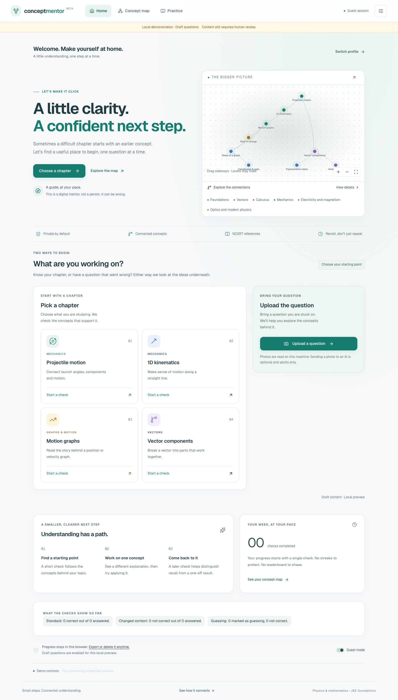
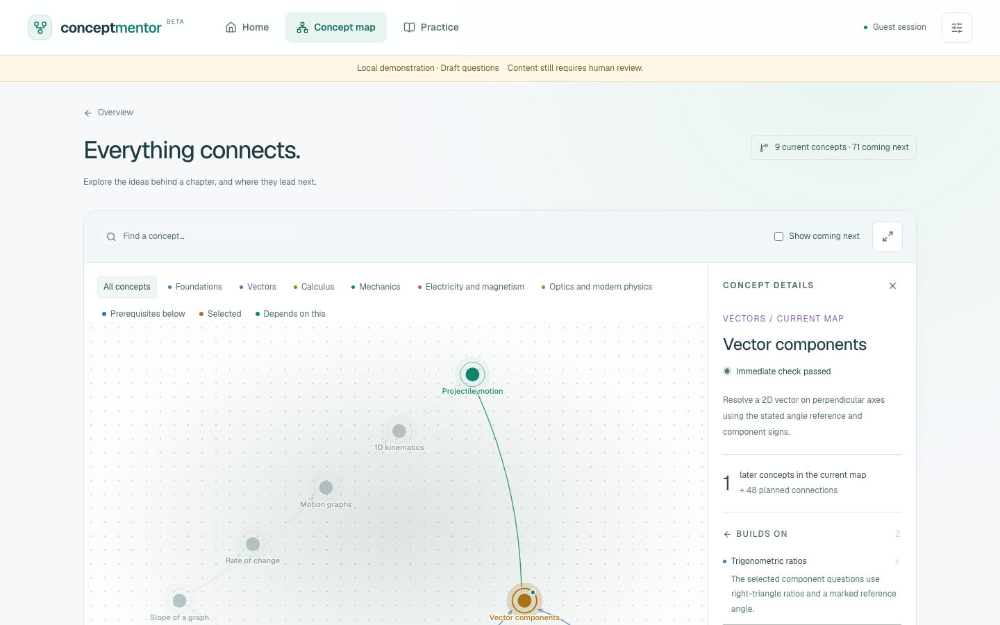

# Concept Mentor

### A little clarity. A confident next step.

**Team Athena · Tejas Agarwal**

Concept Mentor helps students explore the physics and mathematics concepts behind a difficult JEE question. A short check follows the prerequisite map, looks for a suspected contributing gap, and offers a focused explanation, learning resource and later review.

[Explore the idea](idea.md) · [Watch the local demo](submission/athena-local-demo.webm) · [Technical setup](app/README.md)



## The student journey

1. **Choose a starting point.** Pick a chapter or upload a question you are stuck on. Confirm the suggested concept before starting.
2. **Check the ideas underneath.** Answer a small set of standard and changed-context questions, with confidence recorded separately. The diagnostic session has a six-question budget.
3. **Take a focused next step.** Review the relevant concept through an explanation, NCERT reference or curated video, then try an independent check.
4. **Revisit later.** Correctness and confidence guide review intervals through 1, 3, 7, 14, 30, 60 and 120 days. An immediate correct answer does not establish retention.

The app can return an inconclusive result. It does not treat every wrong answer as proof of a missing prerequisite.

## What the site includes

- **Interactive concept map:** prerequisites stay below the concepts that depend on them. Selecting a node highlights prerequisites in blue and dependent concepts in green.
- **Fresh questions from a central bank:** diagnostic and practice requests exclude previously shown questions. When a matching pool runs out, the check stops instead of recycling an item or inventing evidence.
- **Focused learning resources:** explanations, NCERT references and curated lesson links support the repair flow.
- **Device-local profiles:** separate progress, guest sessions, export/import and deletion. A simulated demo profile is explicitly labelled.
- **Optional AI assistance:** a Cline SDK integration can suggest routes through validated tools. Server code controls grading and progress, with a deterministic fallback.
- **Light, responsive interface:** English wording, clear navigation and no leaderboards, streaks or student rankings.



## Run locally

Requires **Node.js 22 or newer**.

```sh
git clone https://github.com/tejasagarwaliitg/ConceptMentor.git
cd ConceptMentor/app
npm ci
cp .env.example .env.local
```

For the local demonstration, set the following in `.env.local`:

```dotenv
SERVE_UNAPPROVED=true
```

Then start the site:

```sh
npm run dev
```

Open [localhost:3000](http://localhost:3000). Create a profile, continue as a guest, or select the simulated demo profile. AI credentials are optional for the deterministic learning flow. Keep `.env.local` private and preserve it if it already exists.

## Current status

This repository is a hackathon prototype. The published bank contains **27 authored diagnostic drafts across nine concepts**, plus a small imported practice pool. No bank entries are human-approved in this version.

**Draft questions are available only in the local development preview. Production blocks unapproved content**, even when `SERVE_UNAPPROVED=true`. The bank needs human review and more independent variants before sustained revision is practical. See the [question review sheet](submission/QUESTION-REVIEW.md).

Local development may be ahead of the published repository. This README describes the code in this repository; screenshots illustrate the recorded local demonstration. No learner study or proven learning gains are claimed.

## Technology and checks

Next.js 16 · React 19 · TypeScript · Tailwind CSS · D3 · KaTeX · Zod · Cline SDK · Vitest · Playwright

Run from `app/`:

```sh
npm run typecheck
npm test
npm run lint
npm run build
```

With the development server running:

```sh
node scripts/ui-smoke.mjs
```

## Repository layout

| Path | Contents |
| --- | --- |
| [`app/`](app/) | Next.js site, components, server routes and tests |
| [`app/content/`](app/content/) | Concept graph, question bank and learning resources |
| [`app/lib/`](app/lib/) | Diagnostic engine, grading, revision and optional integrations |
| [`idea.md`](idea.md) | Product idea and evidence policy |
| [`docs/`](docs/) | Graph documentation and earlier idea versions |
| [`submission/`](submission/) | Demo recording, screenshots and review materials |
| [`output/`](output/) | Presentation files |

For hosting, use **`app` as the project root**, configure a private `ITEM_SECRET`, and complete question approval before expecting production checks to serve content. Optional AI and Telegram integrations require their own configuration; see [the environment template](app/.env.example).
